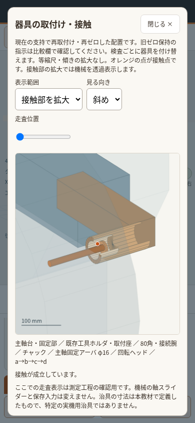

# 旋盤・横形：有限治具とゼロ保持の実装・独立再確認

前回の全7機種監査で未完とした、旋盤の有限穴接触と横形の長い未定義腕を修正した。追加調査で見つかった旋盤の面計器・バーの取付けも対象に含めた。修正担当2名、独立計算担当2名、実ブラウザー担当、独立最終レビュー担当を分離した。

製品版は [`c33e9f02`](https://github.com/tgkfnfnfv9-stack/Training-tools/commit/c33e9f02e30559cee9ab3c4727785a30f59f5baa)。[確認用アプリ](https://raw.githack.com/tgkfnfnfv9-stack/Training-tools/c33e9f02e30559cee9ab3c4727785a30f59f5baa/index.html)。HTML SHA256は `812d4d706652b11ce88801f93b2e88370e28b9d4f002417db1d9ecf94302456e`。GitHub Pages本番への反映やmainへのマージではない。

開始点は前回PRの `c3768bc1a73832e73ae256fe598ba02a3fffd574`。再取得したmainは `baede5bfafed034f5f7d21ec9957e344dc7c8c98`。[前回の全7機種・124数値監査](../qa-all-measurements-20261011/README.md)を置き換えず、今回対象とする2機種の主測定29項目（横形17・旋盤12）を追補する。新設のR方向合わせ3項目と保持比較も別途検証する。

## 変わったこと

- **横形**：パレットに高さ850 mmの箱形台を固定し、有限寸法の調整足・マスタ・計器本体・短い腕を取り付ける。XYは上面でR合わせしてからS用へ付け替える。規定位置、全300 mmの移動範囲、台の据付面積、器具・主軸側との干渉を確認する。
- **旋盤の穴**：タレットの実工具座につながるホルダ、内径50 mm・深さ60 mm、半径1 mmの球測定子、回転ヘッドと有限アーバを定義。傾いた有限円筒の内壁との接触を計算する。穴中心の投影だけでは済ませない。
- **旋盤の面**：主軸台の実前面から有限φ40 mmの検査梁を固定し、チャックを回避する。Zの検査面は主軸寄りフラットへ変更。取付座のない空間へ計器を生成しない。
- **バー**：両機種ともφ50×400 mm。横形は鼻端前350→50 mm、旋盤は50→350 mmを走査。有限の計器腕・本体・ストローク・接触範囲を検査する。TIRの固有参照も50/350 mm位置で再計算する。
- **画面**：「測定位置へ」で実際の軸を移動する。等縮尺の取付図、R/S工程と走査位置、接触部拡大、初回取付け・旧ゼロ保持と再測定の比較を追加。無効な測定に0や接触成立点を表示しない。

計算を変更する前に、旧式の問題、変更式と配置、再ゼロ条件、保存影響をユーザーへ説明した。[説明記録](change-rationale.md)、[横形の具体仕様](horizontal-implementation.md)、[旋盤の具体仕様](lathe-design.md)。

## アプリでの確認

1. 旋盤または横形を選び、下の「検査配置」で検査を選ぶ。
2. 「測定位置へ」を押す。実際の軸表示・保存位置が変わる。寸法や接触が不適合なら理由が表示される。
3. 「器具の取付け・接触を見る」で取付先・動く部材・接触点を確認する。取付け全体と接触部拡大、3方向を切り替えられる。図の走査スライダーは実軸と保存入力を変えない。
4. 「取付けとゼロを保持して支持調整を比較」を開き、「今の取付けとゼロを保持」を押す。支持を上下すると操作前・旧ゼロ保持・再取付け再ゼロを並べて確認できる。

大きい数字は整数µm、その下は生値。微小差が整数に現れない場合も隠さない。保持比較は最初の同じ走査区間の終点、穴は各方位の指示である。取付図は現在の支持で再取付けした配置を示し、旧ゼロ保持の取付図とは混同しない。

## 取付け・動く部材・ゼロ

|検査|基準物・取付先|計器・動く部材|接触とゼロ|
|---|---|---|---|
|横形XY/YZ|パレット上の箱台・直角マスタ|主軸側計器。Sは主軸頭Yを下端→中央300 mm|R合わせ後、S用へ付替え・始点ゼロ。走査中は固定|
|横形XZ|パレット上の箱台・横置きマスタ|計器は主軸側で停止、パレットZが300 mm移動|XでR合わせ後、S始点ゼロ。途中は再方向合わせなし|
|横形バーa/b|主軸固定の校正円筒|計器はパレット箱台。Z＋で主軸側へ300 mm|aは左から、bは下から。鼻端前350 mmでゼロ→50 mm|
|旋盤面X/Z|タレット前面／主軸寄りフラット|主軸台固定梁の計器。Xはタレット、Zは往復台が移動|面法線へ測定子を合わせ始点ゼロ。実位置から300 mm|
|旋盤穴a/b/c/d|タレット所有の有限ホルダ|主軸にアーバ・回転計器を固定、a→b→c→dへ回す|実X/Zで接触。再取付けでは深さ30 mmへ設定しa再ゼロ|
|旋盤バー側面/上面|主軸固定の校正円筒|タレット実工具座の有限腕。Z＋300 mm|側面は奥から、上面は上から。鼻端50 mmでゼロ→350 mm|
|両機種の回転TIR|同じ有限取付位置を利用する50/350 mmの固有参照|計器を各測定位置で停止し、主軸回転の最大−最小|偏心と傾きから得る固有成分。旧ゼロ保持の瞬間指示とは別|
|横形上面9点・最大差|個体に属する上面固有形状|支持姿勢を除いた形状参照。主軸との総指示ではない|最小二乗平面を除去し左中央ゼロ。支持操作で再抽選しない|

バー平行度は回転振れ成分を含めない校正円筒の中心軸基準測定である。回転TIRは別の固有成分参照で、同じ偏心バーの固定回転位相を重ねた総指示とはしていない。主測定29項目の定義確認は[別担当の最終レビュー](coverage-review.md)を参照。

## 同じ支持操作でもゼロ条件が異なる

used seed123456、標準寸法、各規定測定位置。全支持0で取り付け、Bを+0.010 mm。単位µm。

|測定|再取付け・再ゼロ後|旧取付け・旧ゼロ保持|整数 再取付け／保持|
|---|---:|---:|---|
|横形XY|16.959000|13.409849|+17／+13|
|横形XZ|9.486654|6.605385|+9／+7|
|横形YZ|−12.897110|−6.701607|−13／−7|
|旋盤面X|−3.757939|−4.132978|−4／−4|
|旋盤面Z|−8.576993|−11.402006|−9／−11|
|旋盤穴a|0|−2.825006|0／−3|

各値は製品の読値を正解として埋め込んだ期待値ではない。保存入力から別の支持補間・部材姿勢・器具配置を組み立て、面/円筒までの距離を別手法で解いた結果と照合した。横形XYや旋盤面Xで再ゼロ後の値が不変でも、保持した指示は変化する。「取付け保持で始点だけ再ゼロ」も独立記録に分けてある。

## 修正前後を同じ入力で比較

旋盤、used seed123456、幅4 m・奥行1.68 m、X=−57.142857…%、Z=−100%、B=+0.010 mm、他支持0。各検査の再取付け・再ゼロ値。単位µm。

|測定|修正前の生値|修正後の生値|独立期待値|整数 前→後|
|---|---:|---:|---:|---|
|穴b|89.783223|82.928759|82.928759|+90→+83|
|穴の対向差 高さ|−2.581416|−2.527844|−2.527844|−3→−3|
|面X|−3.757939|−3.757939|−3.757939|−4→−4|
|面Z|8.576993|−8.576993|−8.576993|+9→−9|
|バー上面|−0.006345|−0.006324|−0.006324|0→0|

穴は有限円筒・検査深さ30 mmへの変更。面Zは接触するフラットと押込み方向を変更した結果であり、一律の符号反転ではない。TIRは旧0/300 mmと新50/350 mmを同一位置として差分化しない。[生値の全桁・入力・残差・保持3列](lathe-independent-summary.json)、[横形を含む全入力の前後比較](browser/comparison.json)を参照。

## 独立再確認

|確認|結果|記録|
|---|---|---|
|修正前の実ブラウザー|6群・1,262状態・16,881チェック、失敗/例外0、223画像|[前後画像と観測値](browser/README.md)|
|修正後の実ブラウザー|7群・1,665状態・94,049チェック、失敗/例外0、602画像|[同一入力・全支持・保持・保存・図](browser/README.md)|
|横形の入力からの別計算|936行・1872比較、失敗0、最大差1.825×10⁻⁹ µm|[数値・保持・式](independent-design.md)|
|横形の最終ブラウザーと独立期待値|715記録・38,171比較、raw/整数DOM/有効判定の不一致0、最大差1.825×10⁻⁹ µm|[最終集計](independent-horizontal-browser-summary.json)|
|横形の有限形状|120ケース・508,752チェック、違反0|[接触と干渉](independent-horizontal-clearance.json)|
|横形の寸法/コラム境界|96状態・480読値、有効195/無効285が双方向一致|[境界](independent-horizontal-boundaries.json)|
|旋盤の有限穴|727入力・1819モード・42,462チェック、失敗0、最大差7.425×10⁻¹⁰ µm|[独立計算](lathe-independent.md)|
|旋盤の面/バー/TIR|663入力・2004比較・14,292チェック、失敗0、最大差5.933×10⁻¹⁰ µm|[独立結果](lathe-scans-independent-results.json)|
|旋盤の最終ブラウザーと独立期待値|950記録・30,980比較、raw/整数DOM/有効判定の不一致0、最大差5.933×10⁻¹⁰ µm|[最終集計と前後・保持例](lathe-independent-summary.json)|
|50/350 mm固有TIR|16ケース、失敗0、最大差3.43×10⁻¹² µm|[別の回転接触計算](independent-tir-50-350.json)|
|共通エンジン・他機種|既存16テストすべて成功|[出力ログ](regressions/core.json)|
|横形の実装契約|342チェック成功|[回帰確認](horizontal-regression.json)|
|旧保存と同一JSON再読込|2機種・17入力field差分0、保持解除、一時取付け非保存|[独立保存確認](coverage-save-review.json)|
|固定commitの公開確認用アプリ|実Chromium・TLS検証有効、HTTP200・HTML SHA一致、両機種の支持操作と保持比較成功|[配信確認・実画像](preview/README.md)|

表の各行は重複する確認を含むため合算しない。前回記録したmainにも存在する既存テスト失敗は[前回の個別分析](../qa-all-measurements-20261011/regressions/README.md)に残す。今回の規定位置・有限治具と異なる旧検査配置の試験を、そのまま新仕様の正解として採用していない。

修正→独立再確認→再修正では、XYの下面Rと足の干渉、旋盤梁のチャック貫通、測定子伸び0 mmの境界、初回無効のゼロの誤復活、無効接触点の描画、同一JSON読込での保持解除、図のクリップを修正した。担当別記録に反例と再実行結果を残した。

## 実ブラウザー画像と数値

[修正前後の全画像・生値・整数・再現手順](browser/README.md)。実ChromiumのPC幅1280×1000と携帯幅390×844で取得した。携帯幅はタッチのエミュレーションであり、実iPhone/Safariではない。

上記全量集計に加え、標準寸法・used・規定測定位置・支持B+0.010 mmの横形を同一入力で各1状態・1画像ずつ追加取得した（修正前19／後59チェック成功）。数値と軸位置を併記した[前後リンク](browser/README.md#実画面の前後リンク)を参照。

固定コミットの配信先でも、[横形の全体配置図](preview/horizontal-desktop-YZ-fixture.png)と[旋盤穴の接触部拡大](preview/lathe-mobile-bore-contact.png)を取得・目視した。以下は携帯幅で見た旋盤の有限盲穴、主軸側アーバ、球の接触点。

## 保存と適用範囲

支持入力・個体seed・保存schemaを維持した。旧JSONの軸位置を隠れて規定位置へ変更せず、新しい接触条件で再計算する。旧位置では無効になることがある。一時的な器具取付けとゼロは保存しない。軸・寸法・個体の変更、または同一内容を含むJSON読込で保持を解除する。

本検証は有限寸法を定義した剛体教材の幾何を対象とする。円筒を外接箱/包絡で扱う判定は保守的に拒否する場合がある。走査は分割点と支持境界の両側を評価し、全連続時間の形式証明や実機の自重たわみ・締結強度・測定力による変形の認定ではない。これらを理由に、教材内の取付点・腕・穴深さ・接触を未定義のまま残すことはしていない。
